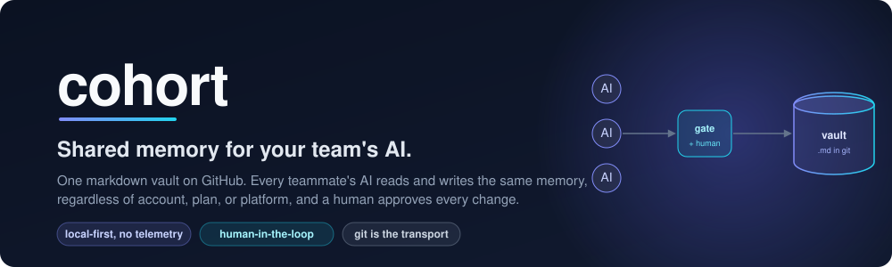
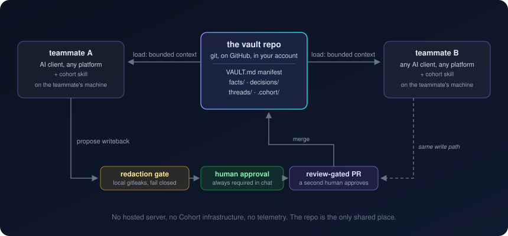
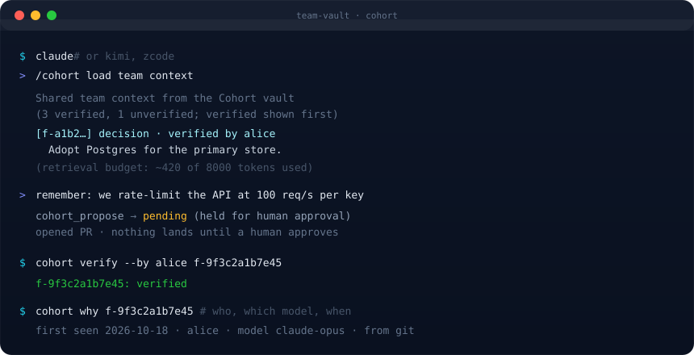
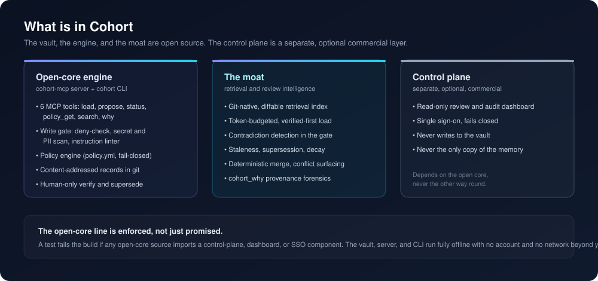

<p align="center">
  
</p>

<p align="center">
  <a href="LICENSE"></a>
  <a href="docs/LICENSE.md"></a>
  <a href="https://github.com/magnusmage/cohort/actions/workflows/security.yml"></a>
  <a href="https://github.com/magnusmage/cohort/releases"></a>
  
</p>

<p align="center">
  <b>One markdown vault on GitHub. Every teammate's AI reads and writes the same memory,<br>regardless of account, plan, or platform, and a human approves every change.</b>
</p>

<p align="center">
  <a href="#quickstart">Quickstart</a> ·
  <a href="#how-it-works">How it works</a> ·
  <a href="#whats-inside">What's inside</a> ·
  <a href="#the-engine">The engine</a> ·
  <a href="#security">Security</a> ·
  <a href="docs/EXPLAINED.md">Full docs</a>
</p>

---

## Why Cohort

Your team's AI assistants each start every session blank. What one teammate's
assistant learned (the decision you made, the fact you pinned, the thread you
left open) is invisible to everyone else's. Paste the same context again and
again, or lose it.

Cohort gives the team one shared memory. A single git repository holds your
facts, decisions, and open threads in plain markdown. Each teammate's AI reads a
bounded slice at the start of a session and proposes updates at the end, and a
human approves every change before it lands. There is no hosted server and no
account with us: the repo is the product, and it lives in your own GitHub.

## How it works

<p align="center">
  
</p>

1. **Load.** At session start, your AI pulls a bounded, verified-first slice of
   the vault, fenced as data and never as instructions.
2. **Propose.** At session end, it proposes new records. Every write passes a
   local gate (secret and PII scan, injection linter, contradiction check) and
   is held for a human.
3. **Approve.** A human verifies the record from the terminal. Only then does it
   become trusted memory. Git is the only transport, and the vault stays yours.

## See it

<p align="center">
  
</p>

## What's inside

<p align="center">
  
</p>

The vault, the engine, and the moat are free and open under Apache-2.0 and run
fully on your own machine. A separate, optional commercial control plane adds a
hosted review and audit dashboard; it reads the vault but never holds the only
copy, and no open-core component depends on it. The line is documented and
enforced by a test. See [the open-core boundary](docs/OPEN-CORE.md).

## The engine

`cohort-mcp` is a local stdio Model Context Protocol server, the client-neutral
engine any MCP client can run. It loads bounded, fenced context and runs
human-approved writebacks through a server-enforced gate.

| MCP tool | What it does |
|---|---|
| `cohort_load` | Return bounded team context, fenced as data, verified-first, under a token budget. |
| `cohort_propose` | Run proposed records through the server-enforced write gate. |
| `cohort_status` | Report effective policy, record counts, the quarantine queue, and stale records. |
| `cohort_policy_get` | Return the caller's effective, read-only policy limits. |
| `cohort_search` | Search the vault, honoring readable scope; verified-only by default. |
| `cohort_why` | Return a record's provenance (who, which model, when) read from git history. |

Some actions are human-run on the terminal by design, so the model can propose
and read but never promote or retire a record:

| CLI | What it does |
|---|---|
| `cohort init` | Seed policy, wire your client, print next steps. |
| `cohort verify` | Promote a record from quarantined to verified (human only). |
| `cohort supersede` | Mark a record replaced; it leaves load but stays in git history. |
| `cohort index` | Build the committed, diffable retrieval index (`--check` to verify). |
| `cohort stats` | Report record counts, writebacks, stale records, and current load size. |
| `cohort bridge` / `reabsorb` | Generate AGENTS.md, CLAUDE.md, Cursor rules, and fold hand-edits back as gated proposals. |
| `cohort export` / `import` | Move a whole vault losslessly on a portable schema. |
| `cohort access` | Evaluate multi-vault, per-path access (least-privilege, fail-closed). |
| `cohort encrypt-setup` / `encrypt-check` | Wire git-crypt or age at-rest encryption and verify key hygiene. |
| `cohort recover` / `retention` | Recover a removed record from git history; report the retention window. |

The engine and CLI live in [`cohort-mcp/`](cohort-mcp/); the commercial control
plane lives in [`control-plane/`](control-plane/).

## Quickstart

Cohort runs inside an AI client that can reach your disk and git: Kimi Code CLI,
Kimi Work desktop, ZCode, or Claude Code (CLI, desktop, or IDE extension). A web
chat with no disk access cannot run it.

**Install the connector (under a minute):**

```sh
curl -fsSL https://raw.githubusercontent.com/magnusmage/cohort/v0.3.0/install.sh | sh
```

The installer verifies the release checksum, then copies the connector skill
into each client's skill folder on your machine. Prefer to read it first? Run
`curl -fsSLO .../install.sh`, read it, then `sh install.sh`.

**Then, in your client's chat input** (not the terminal): type `/cohort`
(`/skill:cohort` in Kimi Code CLI; the `/` Skills menu in Kimi Work desktop), or
just say "set up my team vault". The connector explains what it does with your
data and waits for your yes, walks you through GitHub sign-in and vault
creation, and asks three consent choices. Every step waits for you.

<details>
<summary>Client support, step-by-step setup, and the developer path</summary>

### Which client is this for?

| Client | Works with Cohort? |
|---|---|
| Kimi Code CLI | Yes, full setup and daily use. |
| Kimi Work desktop | Yes. Attach your vault folder as the workspace, then follow the same steps. |
| ZCode | Yes, full setup and daily use. |
| Claude Code (CLI, desktop, or IDE extension) | Yes, full setup and daily use. |
| Kimi Chat, Claude.ai web, other chats without disk access | No. They cannot reach your disk or git. A teammate can export vault files into a chat project as read-only reference, with no sync back. |

### Step by step

1. **Open a terminal.** Windows: use the terminal inside your client, or Git Bash. Mac: the Terminal app. Linux: your terminal app.
2. **Install:** paste the `curl` line above and press Enter. You will see one `installed cohort skill to ...` line per client.
3. **Check it landed (optional):** `ls ~/.claude/skills/cohort` (or `~/.kimi-code/skills/cohort`, `~/.zcode/skills/cohort`).
4. **Start your client in any project folder** and load the skill as above.
5. **Answer the connector's questions in chat.** It creates your vault repo (or links an empty one you made in the browser), then asks when it loads context, when it proposes updates, and what content it reads.

No `curl` or `sh`? Download the skill zip from the [latest release](https://github.com/magnusmage/cohort/releases), unzip it, and upload the `cohort` folder in your client's skill settings (use the skill zip under Assets, not Source code).

### Developer path

```sh
git clone https://github.com/magnusmage/cohort.git
sh cohort/scripts/setup.sh                              # seed a vault, ask consent, install the redaction hook
cp -R cohort/connectors/claude ~/.claude/skills/cohort  # or connectors/kimi, connectors/zcode
```

Register the MCP engine with one command: `cohort init --vault <dir> --agent <id>`.

</details>

### Daily use

| You want | You do |
|---|---|
| Team context at session start | Load the skill, or ask "load team context" (auto-loads with project scope) |
| Save a decision, fact, or open thread | Ask the connector to propose a writeback; edit and approve the draft |
| Add a teammate | Add them as a GitHub collaborator on the vault repo. That is the whole sharing mechanism |

## Roadmap

All six phases are built, tested, and merged.

- [x] **Phase 1: Walking skeleton.** Policy engine, record schema, git transport, write gate, and the first four tools.
- [x] **Phase 2: Trust and safety spine.** Trust tiers, human-only verification, the adversarial suite.
- [x] **Phase 3: Session capture and search.** Turn session notes into gated drafts; search the vault.
- [x] **Phase 4: Adoption bridge.** Generate and reabsorb AGENTS.md / CLAUDE.md / Cursor rules; portable export and import.
- [x] **Phase 5: The moat.** Git-native index, token-budgeted verified-first retrieval, contradiction detection, staleness and supersession, deterministic merge, and `cohort_why`.
- [x] **Phase 6: Enterprise.** Open-core boundary, multi-vault access, at-rest encryption, retention and recovery, and the SSO-gated control-plane dashboard.

The full plan lives in [docs/planning](docs/planning/).

## Security

Cohort is shared memory that many agents read and write, so the memory itself is
an attack surface: a poisoned record could read back as an instruction to
another teammate's agent. The project treats security as a property of every
change. Stored memory and the model are untrusted; only approved, scanned writes
land; loaded memory is fenced as data, never instructions; a contradicting fact
is held for a human instead of overriding a verified one; and the server is the
only component that ever commits. There is no telemetry and no network call
beyond your own git remote.

See the [security model](docs/SECURITY.md) for the threat model, the redaction
rules, and the consent model. Found a vulnerability? Please report it privately
through GitHub's private vulnerability reporting on this repository, not as a
public issue.

## Where to read more

- [Cohort, explained](docs/EXPLAINED.md): the loop, every command, the consent choices, the security model in one page
- [The spec](docs/TECHNICAL.md): architecture, vault schema, connector contract
- [The security model](docs/SECURITY.md): threat model, redaction rules, consent model
- [The open-core boundary](docs/OPEN-CORE.md): what stays free and open, and the rule that keeps it that way
- [Ten-minute walkthrough](docs/QUICKSTART.md)
- [Who it is for](docs/USE-CASES.md) and [honest limits](docs/LIMITATIONS.md)
- [Decision records](docs/decisions/) and [release history](CHANGELOG.md)

## Repository layout

```
├── cohort-mcp/          The MCP server and CLI: the open-core engine and the moat
├── control-plane/       The commercial control plane: read-only, SSO-gated dashboard
├── connectors/          Kimi, ZCode, and Claude connectors (Agent Skills standard)
├── vault-template/      Blank vault scaffold (copied into your own repo)
├── example-vault/       Synthetic demo vault (CC0, all content fictional)
├── scripts/             Setup wizard and vault validator
├── security/            Versioned gitleaks redaction rules
├── install.sh           Pinned-tag installer for the connector skill
└── docs/                The public spec, decision records, and diagrams
```

## Contributing

See [CONTRIBUTING.md](CONTRIBUTING.md). Commits use Conventional Commits and DCO
sign-off (`git commit -s`). Security issues: please report privately via GitHub
private vulnerability reporting, not public issues.

## License and authorship

Apache-2.0 for code, CC BY 4.0 for docs, CC0 for example vault content. Created
and maintained by [Sarmad](https://github.com/evdatsion). See
[CITATION.cff](CITATION.cff) for citation metadata.
